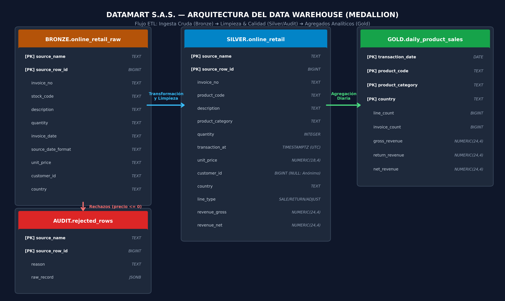

# DataMart S.A.S. — Pipeline ETL

Repositorio Git: https://github.com/roviraromario/data-smart-sytem

Pipeline diario con Apache Airflow y PostgreSQL.
Arquitectura Bronze → Silver → Gold.

---

## Requisitos

- Docker Desktop instalado y corriendo.
- Python 3 para generar las credenciales locales.
- Los dos archivos CSV en `Data/Raw/`:
  - `data.csv` (transacciones diarias — [Kaggle](https://www.kaggle.com/datasets/carrie1/ecommerce-data))
  - `Sales Transaction v.4a.csv` (historial — [Kaggle](https://www.kaggle.com/datasets/thedevastator/online-retail-transaction-dataset))

---

## Inicio rápido

```bash
# 1. Genera un .env local con credenciales aleatorias
python scripts/generate_env.py

# 2. Levanta todos los servicios (Airflow + 2 bases PostgreSQL)
docker compose up -d

# 3. Espera ~2 minutos. Airflow estará en:
#    http://localhost:8080   usuario: admin   contraseña: valor de AIRFLOW_ADMIN_PASSWORD en .env
```

El generador no sobrescribe un `.env` existente. Guarda sus credenciales fuera del repositorio y no compartas ni publiques ese archivo. La interfaz de Airflow queda enlazada a `localhost`; para ex[...]

Al arrancar, el entorno configura automáticamente:
- Usuario administrador de Airflow
- La Connection `warehouse_db` al repositorio analítico
- Las Variables `online_retail_csv_path`, `online_retail_ii_csv_path`, `etl_chunk_size` y `max_rejection_rate`

---

## Ejecutar el pipeline

Desde la UI de Airflow (`http://localhost:8080`):
1. Busca el DAG `datamart_etl`
2. Actívalo (toggle) y haz clic en **Trigger DAG**

O desde la terminal:

```bash
docker compose exec airflow-scheduler airflow dags trigger datamart_etl
```

---

## Verificar que funcionó

```bash
# Filas cargadas en Silver (debe ser ~1.075.742)
docker compose exec warehouse-db psql -U datamart -d datamart \
  -c "SELECT COUNT(*) FROM silver.online_retail;"

# Rechazos registrados (debe ser ~2.517)
docker compose exec warehouse-db psql -U datamart -d datamart \
  -c "SELECT COUNT(*) FROM audit.rejected_rows;"

# Aggregados en Gold (debe ser ~616.968)
docker compose exec warehouse-db psql -U datamart -d datamart \
  -c "SELECT COUNT(*) FROM gold.daily_product_sales;"

# Verificar Connection y Variables
docker compose exec airflow-scheduler airflow connections get warehouse_db
docker compose exec airflow-scheduler airflow variables get etl_chunk_size
docker compose exec airflow-scheduler airflow variables get max_rejection_rate
```

---

## Ejecutar las consultas de negocio

```bash
docker compose exec warehouse-db psql -U datamart -d datamart \
  -f /opt/airflow/sql/Validacion/consultas.sql
```

---

## Estructura del repositorio

```
Data-Smart/
├── dags/
│   └── Data-Smart.py          ← DAG de Airflow (orquestación diaria)
├── Src/
│   ├── Etl/
│   │   ├── Bronce.py          ← Extracción CSV → Bronze
│   │   ├── Silver.py          ← Limpieza y reglas de negocio → Silver
│   │   └── Gold.py            ← Agregación diaria → Gold
│   └── Utils/
│       └── Database.py        ← Helper de conexión PostgreSQL
├── SQL/
│   ├── Bronce/create_bronze_tables.sql
│   ├── Silver/create_silver_tables.sql
│   ├── Gold/create_gold_tables.sql
│   └── Validacion/consultas.sql   ← 7 consultas de negocio
├── Data/
│   └── Raw/                   ← Los dos archivos CSV
├── scripts/
│   ├── airflow-init.sh        ← Crea el usuario admin al arrancar
│   └── generate_env.py        ← Genera credenciales aleatorias para .env
├── pyrightconfig.json         ← Configuración del análisis Python
├── docker-compose.yml
├── .env.example
├── .gitignore
├── README.md                  ← este archivo
├── DECISIONES.md              ← decisiones técnicas
└── modelo_datos.png           ← diagrama del modelo de datos
```

---

## Modelo de datos



Ver [DECISIONES.md](DECISIONES.md) para la justificación del diseño.

---

## DAG — Tareas y orden

```
extraer_ventas_diarias_a_bronce ──┐
                                   ├──► transformar_a_silver ──► validar_calidad_de_datos ──► cargar_resultados_a_gold
extraer_historial_a_bronce ───────┘
```

- Reintentos automáticos: 2 intentos con 2 minutos de espera.
- Idempotente: ejecutarlo dos veces produce el mismo resultado (ver DECISIONES.md).
- Schedule: diario (`@daily`).

---

## Reinicio limpio

Para borrar todo y empezar desde cero:

```bash
docker compose down
docker volume rm data-smart_warehouse-db-data
docker compose up -d
```
